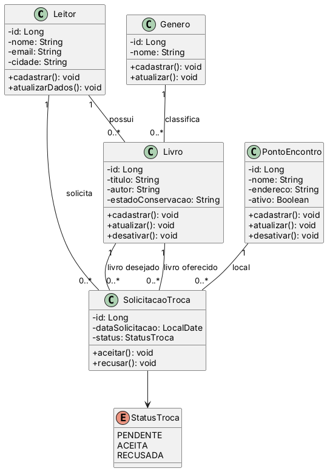

# BookSwap API

[](https://github.com/amandazmn/BookSwap/actions/workflows/ci.yml)


API REST para troca de livros entre leitores. Cada leitor cadastra os livros que tem para trocar, encontra livros de outros leitores por título, autor, gênero ou cidade, e propõe trocas com um ponto de encontro combinado.

> Projeto acadêmico desenvolvido no curso de Engenharia de Software da Católica de Santa Catarina.

## Funcionalidades

- **Leitores:** cadastro com nome, e-mail e cidade, sem e-mail duplicado.
- **Gêneros:** cadastro e atualização, sem nomes repetidos.
- **Livros:** cadastro com estado de conservação (`NOVO`, `SEMINOVO`, `MARCAS_USO`) e busca por título, autor, gênero, cidade ou proprietário.
- **Pontos de encontro:** locais públicos para as trocas, que podem ser desativados.
- **Solicitações de troca:** um leitor oferece um livro seu em troca de um livro de outro leitor; o dono do livro desejado aceita ou recusa.

### Regras de negócio

- O leitor não pode solicitar um livro que já é dele, e o livro oferecido precisa ser do solicitante.
- O livro desejado e o livro oferecido devem ser diferentes.
- A troca só pode ser marcada em um ponto de encontro ativo.
- Só o dono do livro desejado pode aceitar ou recusar a solicitação, e só enquanto ela estiver `PENDENTE`.
- Um livro que já foi trocado não pode entrar em outra troca aceita.
- Livros com solicitações registradas não podem ser removidos, e o proprietário de um livro não pode ser alterado.

## Modelo de domínio



O diagrama também está em PlantUML, em [`docs/diagrama-classes.puml`](docs/diagrama-classes.puml).

## Tecnologias

- Java 17 e Spring Boot 3 (Web, Data JPA, Validation)
- H2 em memória para desenvolvimento e PostgreSQL como banco principal
- **Swagger / OpenAPI** (springdoc) para documentação interativa
- JUnit 5, MockMvc e AssertJ nos testes
- Docker Compose para o PostgreSQL local
- GitHub Actions para integração contínua

## Arquitetura

```
controller  →  service  →  repository  →  banco (H2 / PostgreSQL)
    ↑             ↑
   dto          model (entidades JPA)
```

- **controller:** endpoints REST e validação da entrada.
- **service:** regras de negócio e transações.
- **repository:** acesso a dados com Spring Data JPA, incluindo consultas com filtros dinâmicos.
- **dto:** separa o contrato da API das entidades (records Java).
- **exception:** tratamento global de erros, com respostas padronizadas (`400`, `403`, `404`, `409`).

## Como rodar

**Pré-requisito:** Java 17.

### Com H2 (mais rápido)

```bash
./mvnw spring-boot:run
```

O banco em memória já sobe com dados de exemplo (leitores, gêneros, livros, pontos de encontro e uma solicitação de troca). O console do H2 fica em `http://localhost:8080/h2-console`.

### Com PostgreSQL

```bash
docker compose up -d
./mvnw spring-boot:run -Dspring-boot.run.profiles=postgres
```

A documentação interativa da API fica em **http://localhost:8080/swagger-ui.html**.

## Testes

```bash
./mvnw test
```

Os testes funcionais usam H2 em memória com os dados de exemplo e cobrem cadastros, buscas, validações e as regras de criação e decisão das trocas. Eles rodam automaticamente no GitHub Actions a cada push.

## Endpoints

Todas as rotas começam com `/api/v1`.

| Método   | Rota                        | Descrição                                                  |
|----------|-----------------------------|------------------------------------------------------------|
| `GET/POST` | `/leitores`               | Lista ou cadastra leitores                                 |
| `GET/PUT`  | `/leitores/{id}`          | Consulta ou atualiza leitor                                |
| `GET/POST` | `/generos`                | Lista ou cadastra gêneros                                  |
| `GET/PUT`  | `/generos/{id}`           | Consulta ou atualiza gênero                                |
| `GET`    | `/livros`                   | Busca livros (`titulo`, `autor`, `genero`, `cidade`, `proprietario`) |
| `POST`   | `/livros`                   | Cadastra livro                                             |
| `GET/PUT/DELETE` | `/livros/{id}`      | Consulta, atualiza ou remove livro                         |
| `GET/POST` | `/pontos-encontro`        | Lista pontos ativos ou cadastra ponto                      |
| `GET/PUT`  | `/pontos-encontro/{id}`   | Consulta ou atualiza ponto                                 |
| `DELETE` | `/pontos-encontro/{id}`     | Desativa ponto de encontro                                 |
| `GET`    | `/trocas`                   | Lista solicitações (filtro opcional: `leitor`)             |
| `POST`   | `/trocas`                   | Cria solicitação de troca                                  |
| `GET`    | `/trocas/{id}`              | Consulta solicitação                                       |
| `PATCH`  | `/trocas/{id}/status`       | Aceita ou recusa a solicitação                             |

### Exemplo: propor uma troca

```http
POST /api/v1/trocas
Content-Type: application/json

{
  "solicitanteId": 3,
  "livroDesejadoId": 3,
  "livroOferecidoId": 5,
  "pontoEncontroId": 1
}
```

Mais exemplos, incluindo os casos de erro, estão em [`docs/requisicoes.http`](docs/requisicoes.http), que pode ser executado no IntelliJ ou no VS Code (extensão REST Client).

## Autora

**Amanda Zimmermann** · [LinkedIn](https://www.linkedin.com/in/amandazimn)
